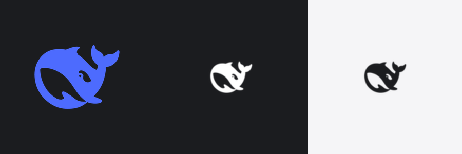

# dsh-linux-app

[](https://github.com/jt-at-home/dsh-linux-app/actions/workflows/ci.yml)

A dedicated Linux desktop app for the
[DeepSeek Harness](https://github.com/deepseek-ai/deepseek-harness) Web UI. An
Electron shell starts its own `dsh web` host, shows the UI in a real application
window, and owns the host's lifetime — so the harness behaves like an app rather
than another browser tab.

> **Unofficial community project.** Not affiliated with or endorsed by DeepSeek.
> "DeepSeek Harness" and the DeepSeek name and marks belong to DeepSeek. The
> whale icon is derived from the DSH web frontend artwork.

## Features

- Dedicated window with tray, hide-on-close, and single-instance focus
- Owns the host: starts `dsh web --profile web --port 0 --no-open`, reads the
  tokenized URL from stdout, and stops the host on quit
- Crash-safe supervision: if the app dies — even via SIGKILL — the host is
  stopped, so no orphan keeps listening on a port
- Native right-click menu: Undo/Redo, Cut/Copy/Paste, Select All, Copy Image,
  Open Link in Browser, Copy Link Address
- Compact app menu behind the **⋯** button: Restart Host, Reload, DevTools,
  Zoom, About, Quit
- Remembers window geometry and zoom; hidden login start with `--hidden`
- In-window error page with Retry when the host fails to start
- Logs rotate at 1 MiB
- AppImage and deb packaging

## Requirements

- `dsh` and a Node version that satisfies its `engines.node` (install with npm or
  nvm)
- `pnpm` only if you install or update plugins (see below)

The app does not bundle a runtime. It resolves `dsh` explicitly and pairs it with
the Node **in the same bin directory**, which matters when it is launched from a
`.desktop` file: a GUI launch has no nvm on `PATH`. If resolution picks the wrong
pair, pin it with `DSH_LINUX_APP_DSH=<path/to/dsh>` or `dshPath` in the config.

## Install

Releases are attached to GitHub Releases as unsigned builds:

| Format | Install / run |
|---|---|
| AppImage | `chmod +x DeepSeek-Harness-<version>-x86_64.AppImage` and run it |
| deb | `sudo apt install ./dsh-linux-app_<version>_amd64.deb` — installs under `/opt/DeepSeek Harness` with a menu entry and `/usr/bin/dsh-linux-app` |

Both still need `dsh` and Node (and pnpm for plugins). The AppImage needs FUSE 2
on some distributions (`libfuse2t64` on Ubuntu 24.04+); otherwise run it with
`APPIMAGE_EXTRACT_AND_RUN=1`.

## Run from source

```bash
npm install
npm start          # real ~/.dsh, real window
npm test           # full suite; needs a display, dsh and ImageMagick

npm run install:desktop    # launcher in ~/.local/bin + menu entry
npm run install:autostart  # start hidden in the tray at login
```

`--hidden` starts the app in the tray without showing the window. If no tray host
appears, it retries for about ten seconds while the panel starts and then shows
the window so the app cannot become unreachable.

### Login start for packaged installs

Point an XDG autostart entry at the installed binary:

```ini
[Desktop Entry]
Type=Application
Name=DeepSeek Harness
Exec=/usr/bin/dsh-linux-app --hidden
Icon=dsh-linux-app
StartupWMClass=deepseek-harness
Terminal=false
X-GNOME-Autostart-enabled=true
```

Save it as `~/.config/autostart/dsh-linux-app.desktop` (for an AppImage, use its
path). The repo's `scripts/install-autostart.sh` can generate this too, including
AppImage paths via `DSH_LINUX_APP_LAUNCHER`.

## Plugins and pnpm

Plugin installs and updates are the one feature that needs software beyond `dsh`
+ Node. The Plugin Market and `dsh plugin` operate on the web profile
(`~/.dsh/profiles/web`) and call `pnpm` directly. The app does not bundle pnpm.

pnpm 12 is the supported line; verify the setup with:

```bash
pnpm --version                                  # 12.x
pnpm -C ~/.dsh/profiles/web list --depth 0      # lists profile dependencies
```

### "pnpm needs to be set up" / "A pnpm executable already exists"

A corepack shim counts as an existing executable but fails `pnpm --version` when
it cannot download pnpm (for example an HTTP 429 from the registry). Since the
shim occupies the name, `npm i -g pnpm` refuses to overwrite it. Either:

```bash
# activate the shim already there
corepack prepare pnpm@latest --activate

# or replace the shim with a real global install
npm i -g pnpm@12 --force
```

Then reload the UI (`Ctrl+R`) or use **⋯ → Restart Host** — the setup check is
cached per host process.

### Plugin updates vs harness updates

- **Plugins:** the Plugin Market / `dsh plugin` installs through pnpm into
  `~/.dsh/profiles/web`. Reload the UI afterwards; some plugins need a host
  restart.
- **Harness (`dsh`):** `npm i -g @deepseek-ai/dsh@latest`, then
  **⋯ → Restart Host**.
- The two are independent: updating `dsh` does not update plugins, and plugin
  updates do not change `dsh`.

## Configuration

Created on first run at `~/.config/dsh-linux-app/config.json` (or under
`$XDG_CONFIG_HOME`). An invalid file is reported and left untouched while
defaults are used.

| Key | Default | Meaning |
|---|---|---|
| `window.width` / `window.height` | `1280` / `860` | Initial window size (600×400 floor) |
| `window.x` / `window.y` | `null` | Saved position; ignored if off-screen |
| `window.maximized` | `false` | Restore maximized |
| `menuBar` | `hidden` | `hidden`, `auto` (Alt reveals) or `visible` |
| `appMenuButton` | `true` | The in-window **⋯** app-menu button |
| `trayIcon` | `auto` | `auto`, `light` or `dark` tray variant |
| `zoom` | `1` | UI zoom factor, 0.5–3 |
| `closeToTray` | `true` | Closing the window hides it instead of quitting |
| `tray` | `true` | Create the tray icon when the desktop supports one |
| `dshPath` / `nodePath` | `null` | Explicit launchers; otherwise auto-resolved |
| `workingDirectory` | `null` | Host working directory; defaults to `$HOME` |
| `hostTimeoutMs` | `120000` | Startup deadline before the error page appears |

Environment overrides: `DSH_LINUX_APP_DSH`, `DSH_LINUX_APP_NODE`,
`DSH_LINUX_APP_CWD`, `DSH_LINUX_APP_CONFIG_DIR`, `DSH_LINUX_APP_STATE_DIR`,
`DSH_LINUX_APP_USER_DATA`, `DSH_LINUX_APP_NO_SANDBOX`.

## Troubleshooting

- **Nothing appears on `npm start`.** The app starts the host first; check
  `~/.local/state/dsh-linux-app/app.log` for `window: loaded visible=…` and
  `host: launching …`. A host failure opens the in-window error page with Retry.
- **`Node X is too old for this dsh`.** The resolved interpreter is older than
  the dsh package's `engines.node`; pin `dshPath`/`nodePath` to a matching pair.
- **Closing the window and nothing on screen.** That is hide-to-tray. Reopen from
  the tray menu, or launch the app again. GNOME needs
  `gnome-shell-extension-appindicator` for a tray; without a tray host the second
  launch is the way back.
- **A second launch does nothing.** The single-instance lock focused the existing
  window; check `pgrep -af dsh-linux-app`.
- **Plugin Market says "pnpm needs to be set up"** — see
  [Plugins and pnpm](#plugins-and-pnpm).
- **`crypto/nss_util.cc … NSS error code`** is Chromium complaining about
  `~/.pki/nssdb`; the UI is loaded over loopback HTTP, so it only affects
  renderer TLS.
- **Logs:** `app.log` / `host.log` under `~/.local/state/dsh-linux-app`; the
  previous megabyte is kept as `.1`.

## Build packages

```bash
npm run package:dir    # unpacked app in dist/linux-unpacked (fast)
npm run package        # AppImage + deb in dist/
npm run smoke:packaged # run the newest build with an isolated home
```

`electron-builder` needs Node 22+ to build. Artifacts are ~120 MB (AppImage) and
~95 MB (deb) because Chromium travels with the app.

## Icons

The mark is the whale from the DSH web frontend (`assets/whale.svg`), drawn on a
transparent background — no square plate:



| File | Use |
|---|---|
| `assets/icon.png` | App/window/desktop icon, 1024×1024, DeepSeek blue `#4D6BFE`, transparent |
| `assets/tray-light.png` | Tray on dark panels, white, 64×64 |
| `assets/tray-dark.png` | Tray on light panels, near-black `#1B1C1F`, 64×64 |

The tray follows `nativeTheme` and swaps between the two variants live; override
with `trayIcon: "light"` or `"dark"` (or `"auto"`, the default). Regenerate
everything from the SVG with:

```bash
npm run make-icons   # requires ImageMagick
```

## Project layout

| Path | Purpose |
|---|---|
| `src/bootstrap.js` | Lifecycle: single instance, host start/retry, window, menu/tray wiring, quit |
| `src/host.js` | Resolves `dsh`/`node`, spawns the host, parses the URL, stops it |
| `src/host-supervisor.mjs` | Parent-death watchdog for the host (stdin pipe) |
| `src/window.js` | Window, partition, cookie cleanup, navigation guards, zoom, error page |
| `src/context-menu.js` | Editing/selection/link/image context menu (pure template builder) |
| `src/config.js` | `config.json` load/normalize/save |
| `src/menu.js` | Application menu and accelerators |
| `src/tray.js` | Tray icon and menu (degrades gracefully without a tray host) |
| `src/preload-app.cjs` | Sandboxed preload that injects the **⋯** app-menu button |
| `src/error-page.js` | Local failure document with Retry/Quit |
| `src/log.js` | App and host logs under the state directory |
| `bin/dsh-linux-app` | Launcher used by the `.desktop` entry |
| `assets/` | Generated icons and their SVG sources |
| `scripts/` | Installers, icon generation, smoke and unit tests |

## Non-goals

- Bundled Node/pnpm/Python runtime and `workspace-dependencies`
- Auto-update, `dsh-app://`, `dsh://` protocol handler
- The reserved `profiles/desktop` profile, frameless/glass chrome
- Replacing the official Desktop on Windows/macOS

## License

MIT — see [LICENSE](LICENSE). The whale artwork is derived from the DeepSeek
Harness web frontend; see the attribution note at the top of this file.
